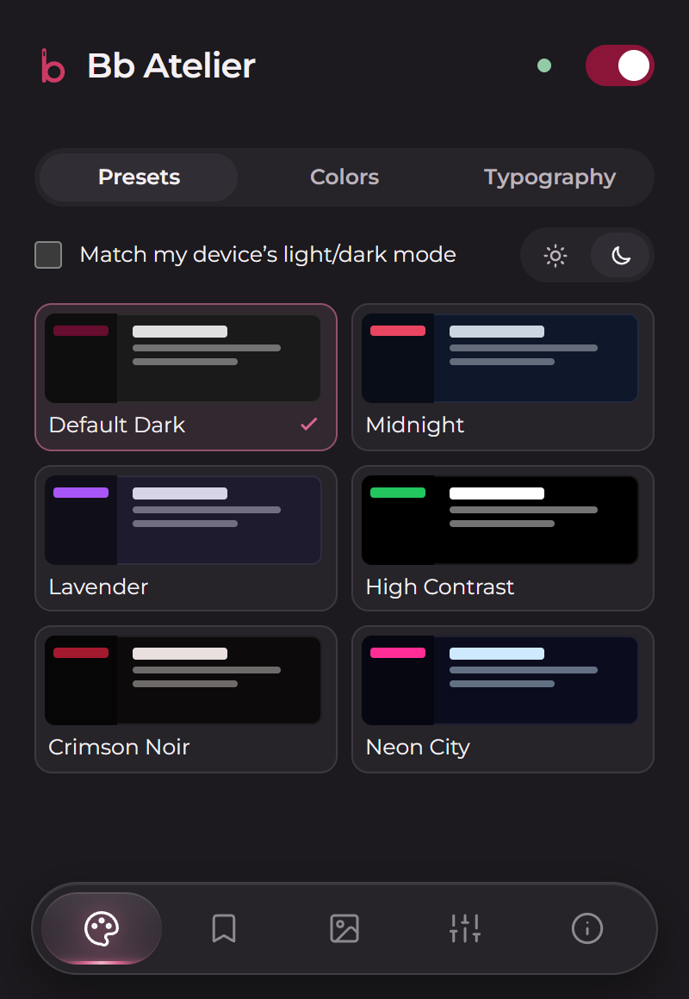
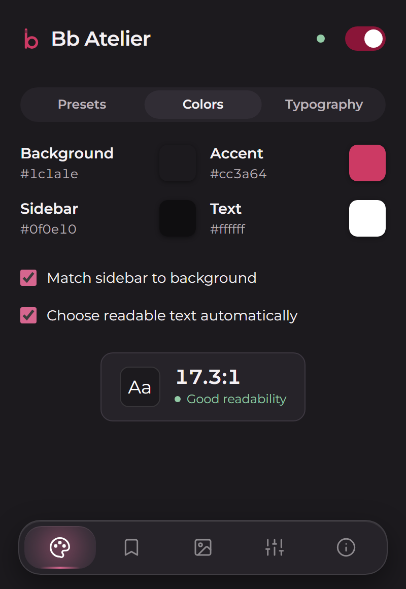
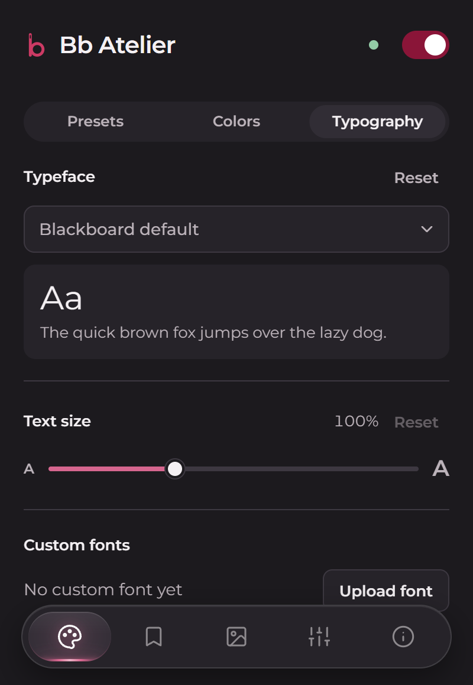

<p align="center">
  
</p>

<h1 align="center">Bb Atelier</h1>

<p align="center">
  <strong>Make Blackboard Ultra feel like yours.</strong><br />
  Themes, fonts and course covers for a calmer, prettier Blackboard.
</p>

<p align="center">
  
  &nbsp;
  
  &nbsp;
  
</p>

https://github.com/user-attachments/assets/2d77eba9-4c1e-48ee-ab37-5b505a3c04bc

---

## Features

- **12 presets**: six light and six dark, from Blossom and Lilac to Midnight and Neon City. Hover any preset to preview it on the page.
- **Your own colours**: background, accent, sidebar and text, with a live readability check.
- **Light and dark, automatically**: keep one light and one dark theme and follow your device's mode.
- **Typefaces**: 20 bundled fonts, or upload your own.
- **Course covers**: upload an image, then move, scale and rotate it to fit the banner.
- **Everywhere in Ultra**: courses, organizations, grades and progress charts, messages, calendar, and the sign-in and sign-out pages.
- **Saved themes and backups**: save looks you love, and export or import everything as one file.

## Install

**Chrome Web Store**: coming soon.

**From source**

1. Install [Node.js](https://nodejs.org) 22.13 or newer, then run:
   ```sh
   npm install
   npm run build
   ```
2. Open `chrome://extensions` and turn on **Developer mode**.
3. Choose **Load unpacked** and select this folder.

Works on Chrome and other Chromium browsers.

## Use

Open Blackboard, click the Bb Atelier icon and pick a preset. Changes apply instantly, without reloading the page.

Bb Atelier works on Qatar University's Blackboard and on `*.blackboard.com`. For another school, open **Settings → Advanced** and connect its Blackboard address.

## Privacy

- Your themes, fonts and covers stay in your browser's extension storage.
- Bb Atelier has no analytics, no tracking and no accounts.
- Feedback is sent only when you press **Send**, and it carries nothing but your note.

| Permission                    | Why                                                 |
| ----------------------------- | --------------------------------------------------- |
| Blackboard sites              | Apply your theme to the pages you open              |
| `storage`, `unlimitedStorage` | Save your themes, fonts, covers and image library   |
| `activeTab`, `scripting`      | Reconnect to an open Blackboard tab after an update |
| Optional site access          | Only for a school address you connect yourself      |

Read the full [privacy policy](PRIVACY.md).

## Development

```sh
npm run dev     # rebuild on change
npm test        # build, then run the test suite
npm run lint    # ESLint and extension checks
npm run package # build, then zip the store upload to dist/bb-atelier-<version>.zip
```

`content.js` and `background.js` are build output, so edit the files in `src/` instead. [AGENTS.md](AGENTS.md) explains how the theme system is organised.

## Feedback

Found a bug or have an idea? Use **About → Send feedback** in the extension, or [open an issue](https://github.com/ashldny/bb-atelier/issues).

<p align="center"><sub>Made by Ashley Danoy, a computer science student at Qatar University.</sub></p>
